# YouthForge Technical Architecture

> Prepared per Section 8 and Section 12 of the build prompt.

---

## 1. High-Level Architecture Diagram

```mermaid
graph TD
    subgraph ClientLayer ["Client Presentation (Next.js 15 + React 19)"]
        Landing["Landing Page (/)"]
        Workspace["Workspace Dashboard (/app)"]
        Intake["Intake & Clarification (/app/new)"]
        Telemetry["Live Telemetry Stream (/app/runs/[id])"]
        Plan["Actionable Plan & Actions (/app/plans/[id])"]
        Verify["Public Proof Portal (/verify/[hash])"]
    end

    subgraph ApiLayer ["Server API Handlers (Next.js App Router)"]
        ApiRuns["/api/runs (Create & List)"]
        ApiEvents["/api/runs/[id]/events (SSE Stream)"]
        ApiActions["/api/runs/[id]/actions (Milestones)"]
        ApiVerify["/api/verify/[hash] (Public Proof)"]
        ApiHealth["/api/health (Diagnostics)"]
    end

    subgraph AgentRuntime ["Autonomous 5-Agent Runtime"]
        Spark["Agent 1: Spark (Coordinator)"]
        Scout["Agent 2: Scout (Research Squad)"]
        Judge["Agent 3: Judge (Feasibility Critic)"]
        Smith["Agent 4: Smith (Action Planner)"]
        Trail["Agent 5: Trail (Milestone Tracker)"]
    end

    subgraph StorageLayer ["Persistence & Proof Layer"]
        RunStore["Stateful Run & Version Store"]
        CanonicalHash["Canonical JSON Normalizer & SHA-256 Engine"]
        TestnetAdapter["Sepolia EAS Testnet Adapter (Ready)"]
    end

    ClientLayer <--> ApiLayer
    ApiLayer <--> AgentRuntime
    AgentRuntime <--> StorageLayer
```

---

## 2. Core Stack Decisions
* **Unified TypeScript Runtime:** Avoids multi-language serialization overhead by running both UI and multi-agent graph in modern TypeScript strict mode.
* **Shared Schema Boundary:** Single source of truth using Zod schemas (`src/lib/schemas/index.ts`) shared between API validation, agent state, and client forms.
* **Real-time Event Streaming:** Server-Sent Events (SSE) with reconnect/resume via `Last-Event-ID` ensures resilient mobile and desktop telemetry.
* **Deterministic Canonical Portability:** SHA-256 hashing over sorted, normalized plan attributes guarantees tamper-evident portability without requiring gas fees or crypto wallets.
