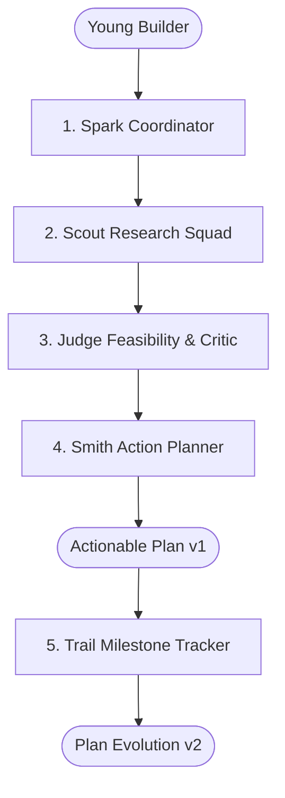

# YouthForge Pitch Deck

> Prepared for Dubai Chambers Create AI Agents Championship  
> Category: Best Youth AI Agent (Top Youth-Led Venture)

---

## Slide 1: Cover & Vision
**Title:** YouthForge  
**Subtitle:** The Autonomous Multi-Agent Venture Validation Studio for Young Builders  
**Tagline:** Built in Dubai, for the Next Generation of Global Innovators.  
**Presenter:** Youth-Led Founding Team (< 21 years of age at registration)  

---

## Slide 2: The Young Founder's Dilemma
* **Ambition vs. Execution:** Thousands of youth have brilliant concepts but stall at the validation hurdle.
* **The Chatbot Illusion:** Standard LLMs act like yes-men—offering vague encouragement with hallucinated statistics and zero accountability.
* **No Verified Traction:** Incubators and juries demand evidence of problem-solution fit, but young founders lack tools to collect and prove research rigor.

---

## Slide 3: The Solution — An Autonomous Venture Studio
* YouthForge is **not a single prompt**. It is a coordinated squad of 5 autonomous specialist agents.
* Converts rough language into an empirical, reality-checked venture blueprint in under 60 seconds.
* Employs real tool calls, external evidence citations, calibrated disagreement, and tamper-evident proof.

---

## Slide 4: The 5-Agent Specialist Architecture

1. **Spark:** Intake, ambiguity detection, research task sequencing.
2. **Scout:** Parallel web search, citation extraction (RTA, WAM, market data).
3. **Judge:** Calibrated 0–100 rubric math, risk register, critic review.
4. **Smith:** 5 concrete next actions (1–14 days), value models, canonical SHA-256 digest.
5. **Trail:** Validates founder milestone evidence, re-scores rubric, advances version.

---

## Slide 5: Real Tools & Verified Evidence
* **Truthfulness Standard:** Every core finding is linked to primary public sources with exact publication dates, URLs, and excerpts.
* **Untrusted Content Sanitization:** Extracted pages are treated as untrusted data, immune to prompt injection attacks.
* **Dual Execution Mode:** Runs against live APIs (Valyu/Tavily/LLMs) or honest cached demonstration evidence (`CACHED DEMONSTRATION EVIDENCE`).

---

## Slide 6: Calibrated Disagreement — The 0–100 Rubric
* **No Sychophancy:** If an idea is flawed, YouthForge says so respectfully.
* **Weighted Evaluation:**
  * Market & Demand Evidence: **25%**
  * Youth Team Execution Feasibility: **25%**
  * Competitive Moat & Unserved Space: **20%**
  * Regulatory & Operational Simplicity: **15%**
  * Data Rigor & Evidence Quality: **15%**
* **Verdict Bands:**
  * **Forge Ahead (70–100):** Clear green light for rapid prototyping.
  * **Refine & Retry (45–69):** Promising core, but specific assumptions need testing.
  * **Rethink (0–44):** High regulatory or unit-economic risk; tests adjacent angles.

---

## Slide 7: Action Over Answers — The First 5 Actions
* Instead of a 40-page theoretical document, Smith outputs 5 concrete validation experiments:
  1. **Interview:** Specific customer discovery questions and sample size.
  2. **Benchmark:** Competitive teardown matrix with observable metrics.
  3. **Prototype:** Scoped single-screen prototype using free open tools.
  4. **Pilot:** Low-cost concierge test with real early adopters.
  5. **Incorporate:** Regulatory and sandbox compliance checklist.
* Each action includes a **Zero-Cost Alternative** and **Observable Completion Condition**.

---

## Slide 8: Privacy-First Cryptographic Proof
* **Zero Minor PII:** No collection of birth dates, national ID scans, or school registries.
* **Canonical SHA-256 Digest:** Normalizes plan keys and computes an immutable hash.
* **Zero Wallet Barrier:** Anyone can verify the authenticity of a plan at `/verify/[hash]` without paying gas fees or connecting Web3 wallets. Sepolia EAS testnet ready for portable credentials.

---

## Slide 9: Business Model & Market Traction
* **Tier 1 (Freemium Youth Access):** Free 3 venture validations per month for individual builders.
* **Tier 2 (Pro Founder):** $15/month for unlimited parallel runs, live deep web crawls, and PDF investor exports.
* **Tier 3 (Institutional Youth Labs):** Annual B2B SaaS licensing for UAE schools, universities, and incubators (Dubai Future Foundation, Hub71, in5).

---

## Slide 10: Roadmap & Dubai Expansion
* **Phase 1 (Completed):** 5-Agent core state graph, calibrated rubric, canonical proof engine, live Next.js studio.
* **Phase 2 (Q1 2027):** Arabic / RTL localized interface, Dubai SME sandbox integration, automated mentor feedback loops.
* **Phase 3 (Grand Final May 2027):** Live on-stage demonstration of fully autonomous, interactive agent orchestration.

---

## Slide 11: The Ask & Commitment
* **Championship Goal:** Winning the **USD 150,000 Best Youth AI Agent Category Grant**.
* **Use of Funds:** 100% dedicated to expanding engineering capabilities in Dubai, funding free access for UAE student founders, and local incubator partnerships.
* **Contact:** Built in Dubai, for the World.
